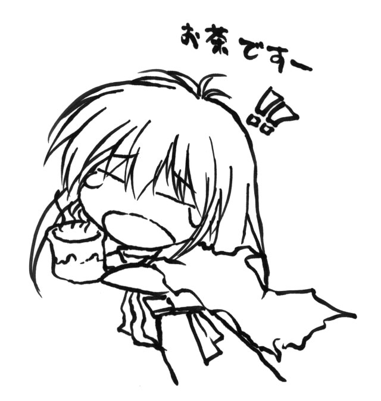

<h1 align="center">nijuuei-va</h1>
<p align="center">

</p>
Dreamcast content patches and rudimentary asset extraction tools for PC versions of KeroQ visual novels.

Vanilla save files may crash depending on where you saved, so starting from scratch after installing the patches is recommended.

Partially based on [gscScriptCompAndDecompiler](https://github.com/TesterTesterov/gscScriptCompAndDecompiler).


## Nijuuei
<details open>
<summary><b>Voice patch</b></summary><br>

Download [Dreamcast assets](https://drive.google.com/drive/folders/1-cwaKLra23hldfvhY3V4RxOwUHBt1RGB?usp=sharing) and put everything in Nijuuei's root folder.

Next, download the [latest patch release](https://github.com/Vast-eel/nijuuei-va/releases/latest) and overwrite the files in the game's `Ksd` directory with the new files.
</details>


<details open>
<summary><b>QoL fixes</b></summary><br>

The game tends to crash or hang after animations on modern machines. To fix this, set the game to fullscreen (even if you want to play it windowed) and download [DxWnd](https://sourceforge.net/projects/dxwnd/).

Open DxWnd's and make sure to enable extended mode in the Options tab. Import `Nijuuei.dxw` from the game's root folder. Right click the preset, press Modify and make sure the path points to `二重影.exe`.

Mount the game's second disc then go into the CDAudio tab, select the "Rip CD Audio" option and run the game once. DxWnd should dump the BGM to a folder named `Music` in the game's directory.

After that, unmount the second disc, set the CDAudio option in DxWnd to "Use audio files" and change the path to point to `二重影_nocd.exe`. You should now be able to play the game without mounting the second disc.
</details>


<details>
<summary><b>Linux troubleshooting</b></summary><br>

The game should run perfectly fine through Wine if you have Japanese fonts and locale properly set up (see [here](https://learnjapanese.moe/vn-linux/#fonts-do-not-look-right)). I last tested it on 10.0.

By default the font rendering is a bit messed up (see wiki as to why). Use the nocd exe to fix this.

As Wine has yet to implement ddraw7's WaitForVerticalBlank function, the game will run at an uncapped framerate, which is probably not something you want (see next section).

The in-game volume sliders don't work. If you think the music's too loud compared to the voices, go into the CDAudio tab, tick Set emulated CD volume, then go into the Sound tab and change CD volume to your liking.
</details>


<details>
<summary><b>High refresh rates</b></summary><br>

Nijuuei's rendering is synced to your monitor's refresh rate. This is fine if you have a 60hz monitor, but it makes everything display way faster if your screen's refresh rate is higher than that. It leads to fading transitions between images being basically nonexistent, for example.

I don't use Windows all that much nowadays, so I wouldn't know what the best solution is to cap the framerate. Try your GPU's control panel or something like RivaTuner, I guess. If they don't budge, try going to the DirectX tab in the DxWnd preset's settings and changing the Renderer to D3D9, then go to the Video tab and lock the bit depth at 32bpp. This will make videos look weird, so preferably don't do it unless you absolutely have to.

If you're a Linux user and the way the graphics display bothers you, do the step mentioned just above with changing the renderer. Make a `dxvk.conf` file in Nijuuei's root directory, edit it and add `d3d9.maxFrameRate = 60` as the first line. If you have DXVK set up in your Wine prefix, this should properly cap the frame rate. Note that, much like this makes videos break on Windows, this is going to screw them up for Linux as well - the DirectX 9 renderer makes the screen go black when one plays and it stays that way until you restart.

Cutscenes use 8bpp images. That may or may not be the reason why D3D9 doesn't play nice with them. I don't have the time to figure out how to fix the issue right now.
</details>


## Moekan
<details open>
<summary><b>Mikoto route + voice patch</b></summary><br>

Download [the main repo](https://github.com/Vast-eel/nijuuei-va/archive/refs/heads/main.zip) and extract it somewhere.

Download [Dreamcast assets](https://drive.google.com/drive/folders/1G2Le9os8uZhP1Gn_i5qpAwLGcpBzGVn2?usp=sharing) and the [latest patch release](https://github.com/Vast-eel/nijuuei-va/releases/latest). Put everything into a `Patch` folder inside the repo directory.

The final directory structure should look like this:
```
nijuuei-va-main
└── Patch
    ├── Kgd
    ├── Ksd
    └── Sounds
        ├── Mikoto
        └── Oyaji
```

Run `moekan_installer.py` and follow what it says.
</details>


## Moekasu
Moekasu, Moetora and Tousui Kitan use an entirely different engine from the previous games called SoW. They don't have console versions to port things from, but for completion's sake I made a script that extracts the .aod format used in those games and a "crack" for Moekasu and Moetora.


<details>
<summary><b>File extractor</b></summary><br>

aod_tool takes .aod file names as arguments - for example, if you want to extract `scr.aod` and `img0.aod`, run `python aod_tool.py scr.aod img0.aod`. Running the script without any arguments extracts all .aod files from the current working directory. Extracting image files might take a while.

Extracted files can be loaded directly by the engine - for example, after extracting `scr.aod`, rename it to something else to prevent the game from loading it (e.g. `scr.aod_old`) then place the extracted `scr` folder next to the game executable.
</details>


<details>
<summary><b>"Crack"</b></summary><br>

For some ungodly reason Moekasu is saddled with SafeDisc 3.2. What's even more puzzling is that the DVD the game comes on has an archive containing the Moetora executable without any copy protection. moekasu_crack extracts this executable so you don't have to play around with bypassing SafeDisc.

To use it, grab `setup.sys` from the DVD and put it in the game directory alongside `moekasu_crack.py` and `aod_tool.py`. Run moekasu_crack. If everything goes right, you should end up with a new executable called `SoW.exe`. Launch it to play the game diskless. This works for both Moekasu and Moetora. See the repo's wiki for technical details (and two alternative methods of getting the games to run if you want to try them instead).
</details>


## Editing
I've included the scripts written for the purposes of this patch. ksd_tool and kpd_tool are for the main scripts and Nijyuei.kpd, while dc_tool has two functions for getting voiced lines from the Dreamcast version's .BIN files and matching them with ksd_tool's decompiled scripts respectively. See the repo's wiki for technical details.

I've applied most of the Dreamcast version's script fixes to the PC version's files. The revised scripts are under Exported/Ksd/Base_Fixes. They're used as the base for the voice patch, the scripts of which you can see under Exported/Ksd/New_Content.